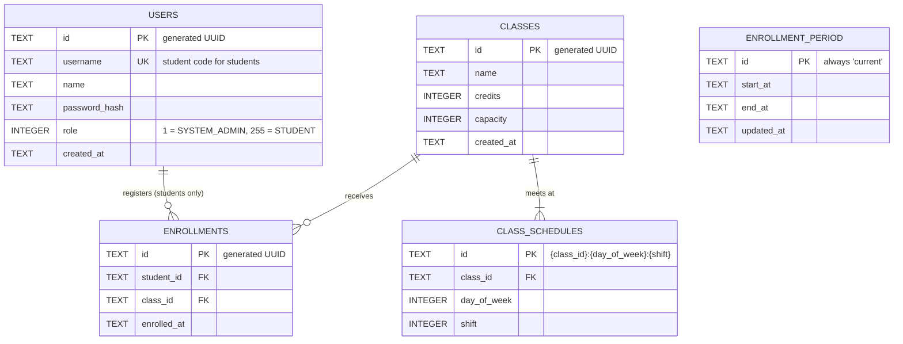

# DB Schema (draft)

Database schema for the registration MVP, stored in SQLite through `DaoSqlite` (`libs/edgeplatform.jar`).

References: [problem statement](../requirements/problem_statement.md), [API specs](api-specs.md), [Sprint 1.5](../sprints/sprint_1.5.md).

## 1. Scope

The schema covers only what the [API specs](api-specs.md) need:

| Table | Serves |
|---|---|
| `users` | Login (username + password), `GET /users/me`, change password, role check |
| `classes` | List, view and create classes |
| `class_schedules` | Class timetable and the schedule-conflict check |
| `enrollment_period` | The single registration period (open/close time) |
| `enrollments` | Register, drop, "my classes" |

Removed from the previous ERD because they are out of scope: `COURSE`, `SEMESTER`, multiple `ENROLLMENT_PERIOD`s, min/max credits per period. `STUDENT` and `SYSTEM_ADMIN` are merged into `users`, because the MVP keeps no data specific to either role. Email is dropped: users sign in with a username, which for students is their student code.

## 2. Constraints from `DaoSqlite`

These come from the library itself and shape every table below.

| Constraint | Consequence for the schema |
|---|---|
| Only `String` → TEXT, `Integer`/`int` → INTEGER, `Boolean`/`boolean` → INTEGER, `Double`/`double` → REAL. Every other type (`Long`, `UUID`, `Instant`, enums, arrays) is stored as BLOB. | IDs, timestamps and enums are stored as `String`. Lists become their own table. |
| `delete(Class, id)` runs `DELETE ... WHERE id = ?`. | Every primary key column is named `id`. |
| Columns support only `PRIMARY KEY`, `NOT NULL`, `UNIQUE`, `AUTOINCREMENT`, `DEFAULT`. No foreign keys, composite unique keys or indexes. | Relationships are enforced by the application. Uniqueness across two columns is enforced either by building the primary key from both (`class_schedules`) or by the service (`enrollments`). |
| Every write is `INSERT OR REPLACE`, auto-committed on its own connection. No transaction spans two calls. | An insert never fails on a duplicate key; it silently overwrites. Read-then-write races are possible (see §5). |
| `INSERT OR REPLACE` also resolves `UNIQUE` conflicts by deleting the other row (verified). | Saving a user whose `username` is already taken **deletes the existing user** instead of failing. The service must check the username is free before saving. |

Conventions:

- Timestamps are ISO-8601 UTC strings with milliseconds, e.g. `2026-11-01T01:00:00.000Z`, written by `TimeUtils.toDbString`. One fixed width keeps string comparison equal to time comparison.
- Generated IDs (users, classes) come from `IdUtils.generateUuid()`: a UUID without dashes, 32 hex chars.

## 3. ERD

## 4. Tables

### 4.1. `users`

| Column | Type | Constraint | Note |
|---|---|---|---|
| `id` | TEXT | PK | Generated by `IdUtils.generateUuid()`. |
| `username` | TEXT | NOT NULL, UNIQUE | Login identifier. For students it is the student code; for admins any unique name. |
| `name` | TEXT | NOT NULL | |
| `password_hash` | TEXT | NOT NULL | Never returned by the API. |
| `role` | INTEGER | NOT NULL | Values from `data/define/UserRole`: `1` = `SYSTEM_ADMIN`, `255` = `STUDENT` (`0` = `GENERIC` is not assigned to users). |
| `created_at` | TEXT | NOT NULL | |

### 4.2. `classes`

| Column | Type | Constraint | Note |
|---|---|---|---|
| `id` | TEXT | PK | `classId` in the API. Generated by `IdUtils.generateUuid()`. |
| `name` | TEXT | NOT NULL | e.g. "Cơ sở dữ liệu - Nhóm 01". |
| `credits` | INTEGER | NOT NULL | > 0 |
| `capacity` | INTEGER | NOT NULL | > 0 |
| `created_at` | TEXT | NOT NULL | |

Seats taken are not stored: `enrolledCount` = number of `enrollments` rows for the class, and `availableSeats = capacity - enrolledCount`.

Classes cannot be edited or deleted while the period is open (out of scope), so `credits`, `capacity` and the schedule are fixed during registration.

### 4.3. `class_schedules`

One row per meeting slot of a class. This replaces the paired arrays `day_in_week` / `day_shift` of the previous ERD, which `DaoSqlite` cannot store.

| Column | Type | Constraint | Note |
|---|---|---|---|
| `id` | TEXT | PK | `{class_id}:{day_of_week}:{shift}`. Building the key from the slot stops the same slot being saved twice for one class. |
| `class_id` | TEXT | NOT NULL | → `classes.id` |
| `day_of_week` | INTEGER | NOT NULL | Values from `data/define/Day`: `1` = Sunday … `7` = Saturday. |
| `shift` | INTEGER | NOT NULL | Values from `data/define/DayShift`: `1` … `4`. |

Schedule conflict: a new class conflicts when it shares any (`day_of_week`, `shift`) with a class the student is already registered in.

### 4.4. `enrollment_period`

Singleton table: one row, `id = 'current'`, matching `GET/PUT /enrollment-periods/current`.

| Column | Type | Constraint | Note |
|---|---|---|---|
| `id` | TEXT | PK | Always `current`. |
| `start_at` | TEXT | NOT NULL | Registration opens (inclusive). |
| `end_at` | TEXT | NOT NULL | Registration closes (exclusive). Must be after `start_at`. |
| `updated_at` | TEXT | NOT NULL | |

The period is open when `start_at <= now < end_at`. Status (`UPCOMING` / `OPEN` / `CLOSED`) is computed, not stored.

### 4.5. `enrollments`

One row per (student, class) the student is currently registered in.

| Column | Type | Constraint | Note |
|---|---|---|---|
| `id` | TEXT | PK | Generated by `IdUtils.generateUuid()`. The database does **not** stop a second row for the same (`student_id`, `class_id`); the service must (G3, see §5). |
| `student_id` | TEXT | NOT NULL | → `users.id` (role `STUDENT`). Taken from the JWT, never from the request. |
| `class_id` | TEXT | NOT NULL | → `classes.id` |
| `enrolled_at` | TEXT | NOT NULL | Commit time of the registration. |

- **Drop** deletes the row, which frees the seat. No `status` column: every row present means `ENROLLED`, which is all `my-classes` returns.
- **Total credits** for the credit-limit check = sum of `classes.credits` over the student's rows. The limit itself is a constant in code, not stored.
- **Duplicates (G3):** before inserting, the service must check that no row exists for this (`student_id`, `class_id`), inside the same lock or transaction as the seat check (§5). That check is also how it answers `ALREADY_ENROLLED`.

## 5. Seat counting and concurrency

G1 (no overbooking) and G3 (no duplicates) cannot rely on the database alone here:

- `DaoSqlite` gives no transaction across calls, so "count the class's enrollments, compare with `capacity`, insert the enrollment" is a read and a write in separate commits. Two students can both see one free seat and both insert.

How the count-and-insert is made atomic is decided in §6.

## 6. Open questions

1. **Atomic registration (blocks G1/G3).** Options:
   - (a) Serialize all writes for a class in the application, e.g. one lock per `class_id`, and do the checks and the insert inside it. Works with the current `Dao` API, and SQLite only allows one writer at a time anyway. It is correct only while there is a single app instance.
   - (b) Add a transactional method to our own subclass of `DaoSqlite` (it exposes `protected dataSource`) that runs the checks (`SELECT COUNT(*) FROM enrollments WHERE class_id = ?` against `capacity`, plus the duplicate, schedule and credit checks) and the insert in one `BEGIN IMMEDIATE` transaction. `BEGIN IMMEDIATE` takes SQLite's write lock before the first read, so no other write can slip in between the count and the insert.

   Recommendation: (b). The database then guarantees correctness, so a missed lock or a second instance cannot overbook.
2. **Refresh tokens.** If refresh tokens are stateless JWTs, no table is needed. Rotation or revocation needs a `refresh_tokens` table. This depends on the security document.
3. **Admin accounts.** How the first `SYSTEM_ADMIN` is created: seed data at startup, or a manual insert.
4. **Indexes.** `DaoSqlite` cannot declare indexes. Lookups by `student_id` and `class_id` are full scans. That should be fine at MVP size (about 2,000 students × a few classes), but a load test should confirm it.
